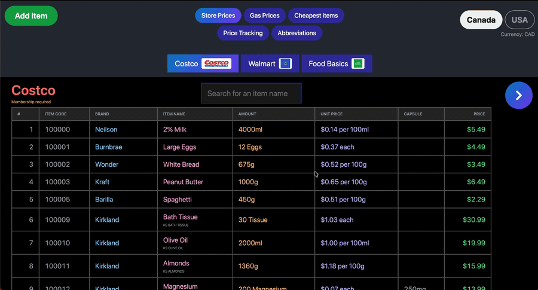
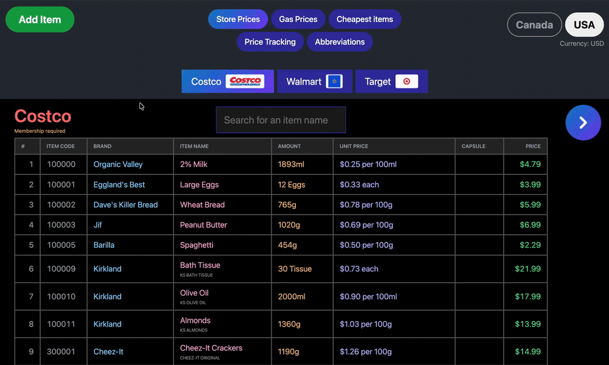

# price-tracking





[](https://github.com/evanpersinger/price-tracking/actions/workflows/ci.yml)

Tracks grocery prices per store in Canada and the USA, so the same item can be compared across stores. Items get in through a receipt photo (read by a local open-source vision model, or by plain OCR), and the app works out which store sells each item cheapest per item, per gram or per ml. Not built yet: adding an item by hand with no receipt.

## Setup

```bash
uv sync
cd frontend && pnpm install
```

Receipt reading is open-source only, no paid API keys. The `local` route needs [Ollama](https://ollama.com) running with a vision model pulled (`ollama pull <model>`). The `script` route needs Tesseract (`brew install tesseract` on macOS) and no model. The `local` route also uses Tesseract to spot gas receipts, and reads every receipt as a grocery one without it.

## Try it with demo data

A fresh clone has an empty database, and adding items needs a receipt photo and a local vision model. To see the app with something in it, fill the database with made-up prices first:

```bash
uv run python backend/seed_demo.py
```

It adds three Canadian and three US stores (real store names), about 70 items, price history and a few gas fill-ups. Every item, price and date is invented. It refuses to run if the database already has stores, so it can't touch real data. To keep the demo apart from a database of your own, set `PRICES_DB` to a new file first, for the script and for the API.

## Run it

```bash
uv run python backend/server.py   # API on http://127.0.0.1:8021, restart it after code changes
cd frontend && pnpm dev           # UI on http://localhost:3009, needs the API running
```

Optional environment variables: `PRICES_DB` (path to a different database, handy for testing on a copy), `OLLAMA_HOST`, and `RECEIPT_MODEL` (the model the API reads receipts with, default `gemma4:12b`).

## Pages

- `/ca` and `/us`: Store Prices, one store at a time, with a search box.
- `/gas/ca` and `/gas/us`: Gas Prices, each station's fill-ups with the price per litre.
- `/cheapest/ca` and `/cheapest/us`: the cheapest items per store, and a search for what every store sells an item for.
- `/tracking/ca` and `/tracking/us`: Price Tracking, a graph of an item's price at one store over time.
- `/abbreviations`: shorthand used in item names, like `SS` for sesame seed.
- The Add Item button: drop a receipt photo, review and edit what the model read, then save the items. The Item name box is the item's display name, and the receipt's printed text is saved next to it.

## API

Prices come back as `price_cents`, and `country` is `CA` or `US`.

- `GET /api/stores?country=CA` each store with its items.
- `GET /api/cheapest?country=CA` each store with the items it sells cheapest, compared per item, per gram or per ml, and produce or bulk items with no size per kg.
- `GET /api/search?country=CA&q=milk` what every store sells an item for, cheapest first.
- `GET /api/history?country=CA` every recorded purchase, newest first.
- `POST /api/items` adds an item. It needs `country`, `store`, `name` (the receipt's printed text), `display_name`, `price_cents` and at least one of `item_count`, `weight_g` or `volume_ml`. An item with an `item_code` and a date is also recorded in the price history. An item that would overwrite a saved one is rejected with a 422 if its price per unit is more than 5 times higher or lower, since that means a typed size is wrong.
- `DELETE /api/items/{id}` deletes an item and its price history.
- `POST /api/receipt` reads a JPEG or PNG (the raw request body) and returns what the model found, saving nothing. One receipt at a time, a second gets a 409.

## Read a receipt from the command line

```bash
uv run python backend/extract_receipt.py local <model>  # or omit <model> to be prompted
uv run python backend/extract_receipt.py script          # plain OCR, no model
```

Converts every image in `backend/input/` (gitignored) and prints the date, store, address and items as JSON, also saved to `backend/output/<image-name>.json`. The command line always picks the model itself, the API uses `RECEIPT_MODEL`.

## Import a store-prices CSV

```bash
uv run python backend/import_sheet.py backend/data/imports/store_prices_ca.csv CA
uv run python backend/import_sheet.py backend/data/imports/store_prices_us.csv US
```

A one-time load of the original price sheets. Those CSVs are in `backend/data/imports/`, which is gitignored, so a fresh clone doesn't have them. Skip this step: use the demo data above, or let the app create an empty database on first use and add items with the Add Item button. With a CSV in hand, the command creates `backend/data/prices.db` (gitignored) with the stores, their discount text, student discounts, items and prices. It refuses to import a country twice, so the database stays the source of truth once items are added to it.

## Run the tests

```bash
uv run pytest                 # backend, from the repo root
cd frontend && pnpm test      # frontend helpers, vitest
```

Every backend test uses its own temporary database, so `prices.db` is never touched. `pnpm build` type-checks and builds, and `pnpm lint` runs oxlint.

## Data rules

How item names, brands and unit prices are stored is in [DATA_CONVENTIONS.md](DATA_CONVENTIONS.md).

## License

MIT, see [LICENSE](LICENSE). Store logos belong to their respective owners and are not covered by this license.
